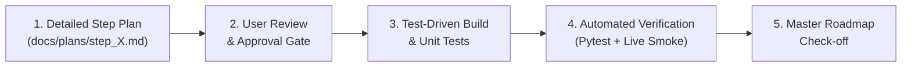

# zioX: Step-by-Step Collaborative Implementation Plan

> **Note**: This file serves as the single source of truth for our build roadmap.
> Every step follows AI-assisted engineering design principles: explicit requirements, architecture design, verifiable test criteria, and user approval gates before code execution.

---

## AI-Assisted Design & Engineering Protocol (Mandatory Workflow)

To guarantee that everything requested is properly designed, implemented, and verified without regressions, every upcoming step will follow this strict lifecycle:

1. **Dedicated Step Plan Document**:
   - For every step, a dedicated design and verification file will be created in `docs/plans/step_XX_<name>.md`.
   - The plan details: Architecture changes, exact file diffs, edge cases, human-in-the-loop UX, anti-ban protections, and verification commands.
2. **Review & Approval Gate**:
   - No code is committed until you inspect and approve the step design.
3. **Safe Simulation by Default**:
   - All tests and executions default to `DRY_RUN=True` to safeguard accounts and API quota.
4. **Verifiable Proof of Delivery**:
   - Every completed step must pass automated pytest suites and a 30-second live verification command before moving forward.

---

## Master Roadmap & Progress

| Step | Focus Area | Status | Files Touched |
| :--- | :--- | :--- | :--- |
| **Step 1** | **Gemini API & Free-Tier Connectivity** | **COMPLETED** | `.env`, `config/settings.py`, `engine/grounding.py` |
| **Step 2** | **Google Search Grounding & Web Fact Citations** | **COMPLETED** | `engine/grounding.py` |
| **Step 3** | **Advocacy Persona & System Prompt Tuning** | **COMPLETED** | `engine/grounding.py`, `engine/humanizer.py` |
| **Step 4** | **Verified Fact & Whitelisted Links Vault** | **COMPLETED** | `assets/proofs/whitelisted_sources.json`, `engine/humanizer.py` |
| **Step 5** | **Virality Threshold & Keyword Calibration** | **COMPLETED** | `config/settings.py`, `engine/virality.py`, `engine/orchestrator.py` |
| **Step 6** | **Multi-Turn Thread State & Anti-Troll Rules** | **COMPLETED** | `engine/thread_state.py` |
| **Step 7** | **Interactive Human-in-the-Loop Mode** | **COMPLETED** | `main.py`, `engine/orchestrator.py` |
| **Step 8A** | **Decoupled Discovery Radar & Tweet Queue** | **COMPLETED** | `engine/radar.py`, `database/schema.py`, `database/repository.py`, `main.py` |
| **Step 8B** | **Targeted Action & Reply Dispatcher** | **COMPLETED** | `engine/orchestrator.py`, `providers/twikit_provider.py`, `main.py` |
| **Step 8C** | **Verified Link Validator & Live Citation Engine** | **COMPLETED** | `docs/plans/step_08c_link_validator.md`, `engine/link_validator.py`, `engine/humanizer.py`, `assets/proofs/whitelisted_sources.json` |
| **Step 9** | **Anti-Ban Stealth Pacing & Rate Limiting** | **COMPLETED** | `docs/plans/step_09_stealth_pacing.md`, `config/settings.py`, `engine/orchestrator.py`, `database/repository.py`, `tests/test_stealth.py` |
| **Step 10** | **External Scheduler & Unified Pipeline** | **COMPLETED** | `docs/plans/step_10_scheduler.md`, `config/settings.py`, `engine/orchestrator.py`, `main.py`, `scripts/run_pipeline.ps1`, `.github/workflows/ziox_cron.yml`, `tests/test_scheduler.py` |
| **Step 11** | **Cloud Persistence via Turso / libSQL Adapter** | **COMPLETED** | `docs/plans/step_11_turso_cloud_db.md`, `pyproject.toml`, `config/settings.py`, `database/repository.py`, `main.py`, `.github/workflows/ziox_cron.yml`, `tests/test_turso_adapter.py` |

---

## Detailed Step Specifications

### Step 1: Gemini API Connectivity & Free Tier Verification (Completed)
* **Goal**: Connect active Free-Tier key to Google's latest `gemini-3.5-flash-lite` model.
* **Result**: Tested and confirmed with live claim evaluation. 9/9 unit tests passing.

---

### Step 2: Google Search Grounding & Web Citations (Completed)
* **Goal**: Equip `GroundingEngine` with Google Search tool support to verify live claims against real-time news, UN records, and government releases.
* **Result**: Implemented with exponential backoff and automatic citation extraction.

---

### Step 3: Advocacy Persona & System Prompt Tuning (Completed)
* **Goal**: Refine prompt voice: "The adult in the room" (rational, composed, authoritative, subtle dry wit). Strict ban on robotic clichés, em-dashes.
* **Language Policy**: Restrict generated replies strictly to **English** and **Arabic** only.
* **Result**: Tested against Arabic, English, and non-target languages. 10/10 unit tests passing.

---

### Step 4: Verified Proof & Whitelisted Links Vault (Completed)
* **Goal**: Build local verified source registry (`whitelisted_sources.json`) containing official primary-source URLs.
* **Result**: Created JSON registry mapping topics & bilingual keywords. Wired into `Humanizer.sanitize()`. 11/11 unit tests passing.

---

### Step 5: Virality Threshold & Keyword Calibration (Completed)
* **Goal**: Calibrate search keywords and fine-tune velocity momentum scoring.
* **Result**: Implemented virality tier classifier (`VIRAL_EXPLOSIVE`, `VIRAL_HIGH`, `VIRAL_EMERGING`). Updated orchestrator to sort candidate posts by momentum. 12/12 unit tests passing.

---

### Step 6: Multi-Turn Conversation & Disengagement Tuning (Completed)
* **Goal**: Validate thread state progression: Turn 1 (Factual rebuttal) $\to$ Turn 2 (Follow-up evidence) $\to$ Turn 3 (Auto-disengage). Instant termination upon detecting abusive trolling.
* **Result**: Added bilingual slur/troll filters. Enforced automatic thread disengagement (`DROPPED_TOXIC`, `COMPLETED`). 13/13 unit tests passing.

---

### Step 7: Interactive Human-in-the-Loop Mode (Completed)
* **Goal**: Add CLI flag `--interactive` that displays proposed replies for review: `[A]pprove & Send / [E]dit Draft / [S]kip Tweet / [Q]uit Cycle`.
* **Result**: Implemented terminal prompt with full context. Added length checking (280-char limit) and editing. 14/14 unit tests passing.

---

### Step 8A: Decoupled Discovery Radar & Tweet Queue (Completed)
* **Goal**: Implement Discovery Radar tool (`engine/radar.py`) that discovers candidate viral tweets across target keywords and queues them into SQLite with `status='DISCOVERED'`.
* **Result**: Schema migration, regex URL parser, virality calculation, CLI flags (`--radar`, `--queue-tweet`, `--queue-list`). 17/17 passing tests.

---

### Step 8B: Targeted Action & Reply Dispatcher (Completed)
* **Goal**: Implement Targeted Action/Responder tool that pulls `DISCOVERED` tweets from the queue, evaluates thread state, runs Gemini grounding, humanizes response, and posts via authenticated session.
* **Result**: `TwikitTwitterProvider` with session cookies, `process_queue()` batch/single tweet dispatcher, strict Twitter 280-char enforcement. 23/23 passing tests.

---

### Step 8C: Verified Link Validator & Live Citation Engine (Completed)
* **Goal**: Solve dead, 404, or 403 links. Establish a Link Validator that checks HTTP health of URLs before attaching them to replies. If a link fails or returns an error, cleanly fallback to verified primary sources or post grounded text without a broken link.
* **Result**:
  - Created [`engine/link_validator.py`](file:///C:/Users/User/PycharmProjects/zioX/engine/link_validator.py) with dual HEAD/GET verification, browser User-Agent headers, and in-memory cache.
  - Audited and updated [`assets/proofs/whitelisted_sources.json`](file:///C:/Users/User/PycharmProjects/zioX/assets/proofs/whitelisted_sources.json), replacing 403-restricted endpoints with verified live IDF databases.
  - Updated [`engine/humanizer.py`](file:///C:/Users/User/PycharmProjects/zioX/engine/humanizer.py) with `resolve_valid_link()` to ensure no dead or 404 links are ever attached.
  - Comprehensive unit test suite: 6/6 dedicated tests in [`tests/test_link_validator.py`](file:///C:/Users/User/PycharmProjects/zioX/tests/test_link_validator.py). Full suite: 29/29 tests passing.

---

### Step 9: Anti-Ban Stealth Pacing & Rate Limiting (Completed)
* **Goal**: Protect accounts from X's anti-bot detection during automated batch runs by introducing randomized human Gaussian typing delays (35–85s), per-cycle burst caps (max 2–3 replies/cycle), and link frequency throttling.
* **Plan File**: [`docs/plans/step_09_stealth_pacing.md`](file:///C:/Users/User/PycharmProjects/zioX/docs/plans/step_09_stealth_pacing.md)
* **Result**:
  - Added stealth pacing & rate limit settings in [`config/settings.py`](file:///C:/Users/User/PycharmProjects/zioX/config/settings.py) (`max_replies_per_cycle`, `min_reply_delay_seconds`, `max_reply_delay_seconds`, `link_cooldown_minutes`).
  - Added link frequency cooldown tracking in [`database/repository.py`](file:///C:/Users/User/PycharmProjects/zioX/database/repository.py) via `is_link_recently_posted()`.
  - Implemented Gaussian jitter delay calculation `calculate_gaussian_jitter()` and delay enforcement in [`engine/orchestrator.py`](file:///C:/Users/User/PycharmProjects/zioX/engine/orchestrator.py).
  - Enforced per-cycle caps on both `run_cycle` and `process_queue`, ensuring queued candidate tweets stay in `DISCOVERED` state for future cycles.
  - Created 6 dedicated unit tests in [`tests/test_stealth.py`](file:///C:/Users/User/PycharmProjects/zioX/tests/test_stealth.py) (6/6 passing). Full test suite: 37/37 passing.

---

### Step 10: External Scheduler & Unified Pipeline Architecture (Completed)
* **Goal**: Transition from a costly, fragile 24/7 daemon loop to a serverless, external scheduler cron architecture. Implement single-command pipeline (`--pipeline`) with human start jitter, monthly ceiling hard-stops, and execution templates for local Windows Task Scheduler and GitHub Actions.
* **Plan File**: [`docs/plans/step_10_scheduler.md`](file:///C:/Users/User/PycharmProjects/zioX/docs/plans/step_10_scheduler.md)
* **Result**:
  - Added `start_jitter_max_minutes` parameter in [`config/settings.py`](file:///C:/Users/User/PycharmProjects/zioX/config/settings.py).
  - Implemented `run_full_pipeline()` in [`engine/orchestrator.py`](file:///C:/Users/User/PycharmProjects/zioX/engine/orchestrator.py) chaining pre-run quota verification $\to$ randomized start-jitter $\to$ Discovery Radar $\to$ Stealth Responder.
  - Added CLI flags `--pipeline` and `--start-jitter` to [`main.py`](file:///C:/Users/User/PycharmProjects/zioX/main.py).
  - Created [`scripts/run_pipeline.ps1`](file:///C:/Users/User/PycharmProjects/zioX/scripts/run_pipeline.ps1) for local scheduled execution via Windows Task Scheduler.
  - Created [`.github/workflows/ziox_cron.yml`](file:///C:/Users/User/PycharmProjects/zioX/.github/workflows/ziox_cron.yml) for automated serverless execution on GitHub Actions.
  - Added 4 dedicated unit tests in [`tests/test_scheduler.py`](file:///C:/Users/User/PycharmProjects/zioX/tests/test_scheduler.py) (4/4 passing). Full test suite: 41/41 passing.

---

### Step 11: Cloud Persistence via Turso / libSQL Database Adapter (Completed)
* **Goal**: Equip `database/repository.py` with dual-engine capability: seamless local `sqlite3` fallback when working offline, and remote HTTPS/libSQL connection when `TURSO_DATABASE_URL` and `TURSO_AUTH_TOKEN` are configured. This enables completely stateless serverless execution on GitHub Actions without committing `.db` binaries to Git.
* **Plan File**: [`docs/plans/step_11_turso_cloud_db.md`](file:///C:/Users/User/PycharmProjects/zioX/docs/plans/step_11_turso_cloud_db.md)
* **Result**:
  - Added `libsql-client>=0.3.0` dependency to [`pyproject.toml`](file:///C:/Users/User/PycharmProjects/zioX/pyproject.toml).
  - Added `turso_database_url` and `turso_auth_token` fields to [`config/settings.py`](file:///C:/Users/User/PycharmProjects/zioX/config/settings.py).
  - Implemented dual-engine in [`database/repository.py`](file:///C:/Users/User/PycharmProjects/zioX/database/repository.py) supporting both local SQLite and remote Turso libSQL execution.
  - Updated [`main.py`](file:///C:/Users/User/PycharmProjects/zioX/main.py) to pass Turso credentials to `Repository` and display target in `--status`.
  - Updated [`.github/workflows/ziox_cron.yml`](file:///C:/Users/User/PycharmProjects/zioX/.github/workflows/ziox_cron.yml) to inject `TURSO_DATABASE_URL` and `TURSO_AUTH_TOKEN` secrets.
  - Created 3 unit tests in [`tests/test_turso_adapter.py`](file:///C:/Users/User/PycharmProjects/zioX/tests/test_turso_adapter.py) (3/3 passing). Full test suite: 44/44 passing.
