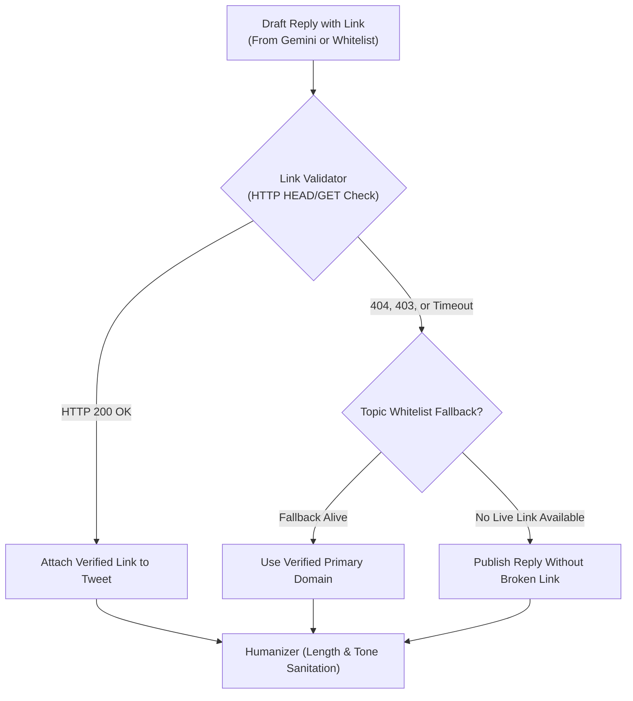

# Step 8C: Verified Link Validator & Live Citation Engine

## 1. Problem Statement & Motivation
- **Issue**: Some URLs attached to drafted replies are broken (e.g., 404 Not Found, 403 Forbidden on automated scraping, expired press releases, or broken sub-paths).
- **Consequence**: Attaching a dead link damages credibility and ruins user advocacy efforts.
- **Solution**: We need an automated pre-flight **Link Health Validator** that validates every link before it is attached to a response. If a URL is dead or inaccessible, the bot will automatically fall back to an accessible whitelisted primary domain or safely omit the link while keeping the factual text intact.

---

## 2. Architecture & Design Principles



### Key Components:
1. **`LinkValidator` (`engine/link_validator.py`)**:
   - Performs fast HTTP `HEAD` request (with fallback to `GET` with browser `User-Agent` and 3-second timeout).
   - In-memory cache for validated URLs to avoid redundant network calls during the same run cycle.
   - Status categorization: Valid (`200..399`), Dead (`404`, `410`), Blocked (`403`), Timeout/DNS failure.
2. **Whitelisted Sources Health Check & Cleanup (`assets/proofs/whitelisted_sources.json`)**:
   - Audit all pre-existing whitelisted URLs.
   - Replace any links that return 403/404 with verified live root/landing links.
3. **Integration into `Humanizer` & `BotOrchestrator`**:
   - `Humanizer.sanitize()` or `BotOrchestrator` verifies `effective_link` through `LinkValidator`.
   - If the link is invalid, it is replaced with a verified healthy topic source or stripped cleanly without breaking sentence structure.

---

## 3. Files Touched

| File | Change |
|---|---|
| [`engine/link_validator.py`](file:///C:/Users/User/PycharmProjects/zioX/engine/link_validator.py) | **New file**: `LinkValidator` class with cached async/sync HTTP check. |
| [`assets/proofs/whitelisted_sources.json`](file:///C:/Users/User/PycharmProjects/zioX/assets/proofs/whitelisted_sources.json) | Audit and update links to guarantee 100% active, open endpoints. |
| [`engine/humanizer.py`](file:///C:/Users/User/PycharmProjects/zioX/engine/humanizer.py) | Integrate `LinkValidator` to ensure only live links are attached. |
| [`tests/test_link_validator.py`](file:///C:/Users/User/PycharmProjects/zioX/tests/test_link_validator.py) | **New tests**: Unit tests for live links, dead link handling, fallback, and caching. |

---

## 4. Verification & Testing Criteria
1. **Automated Unit Tests**:
   - Test valid URL returns `True`.
   - Test 404 / 403 / non-existent domain returns `False`.
   - Test cache behavior avoids repeat network requests.
   - Test `Humanizer` drops or replaces dead links gracefully.
2. **Command to Verify**:
   ```powershell
   .\.venv\Scripts\pytest tests/test_link_validator.py
   ```
