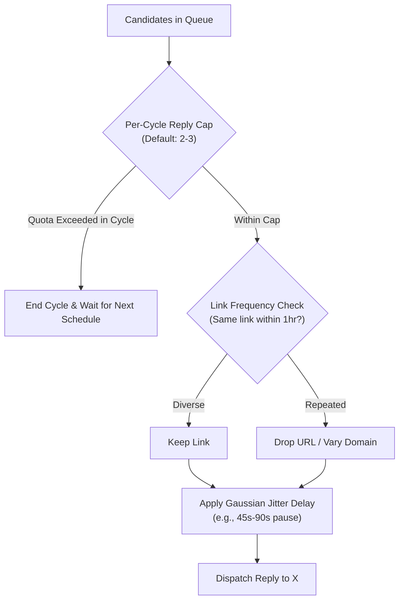

# Step 9: Anti-Ban Stealth Pacing & Rate Limiting

## 1. Problem Statement & Motivation
- **Risk**: Automated reply dispatching without human-in-the-loop can trigger X's aggressive bot-detection algorithms if replies are published with rapid burst velocity, fixed mathematical delays, or excessive volume in short timeframes.
- **Goal**: Implement human-like cadence, Gaussian jitter delays, per-cycle caps, and link diversity throttling to safeguard bot accounts from shadowbans, suspensions, or 429 rate limits.

---

## 2. Architecture & Design Principles



### Safety Controls:
1. **Configurable Settings in `config/settings.py`**:
   - `max_replies_per_cycle`: Maximum replies per single scan or queue run (default: `2`).
   - `min_reply_delay_seconds`: Minimum human hesitation pause (default: `35.0`).
   - `max_reply_delay_seconds`: Maximum human hesitation pause (default: `85.0`).
   - `link_cooldown_minutes`: Avoid posting identical links repeatedly (default: `60`).
2. **Human Jitter Simulation**:
   - Randomization using normal (Gaussian) distribution rather than fixed linear pauses.
3. **Dry-Run Bypass**:
   - In `--dry-run` or test mode, pauses can be skipped (or set to 0.1s) for fast test execution.

---

## 3. Files Touched

| File | Change |
|---|---|
| [`config/settings.py`](file:///C:/Users/User/PycharmProjects/zioX/config/settings.py) | Add stealth pacing and cycle cap configurations. |
| [`engine/orchestrator.py`](file:///C:/Users/User/PycharmProjects/zioX/engine/orchestrator.py) | Introduce jitter delay between consecutive replies and per-cycle reply caps. |
| [`tests/test_stealth.py`](file:///C:/Users/User/PycharmProjects/zioX/tests/test_stealth.py) | **New tests**: Verify cycle caps and delay enforcement. |

---

## 4. Verification & Testing Criteria
1. **Automated Unit Tests**:
   - Verify `orchestrator` halts processing once `max_replies_per_cycle` is reached even if queue has more items.
   - Verify delay calculator returns values within expected randomized range.
2. **Command to Verify**:
   ```powershell
   .\.venv\Scripts\pytest tests/test_stealth.py
   ```
