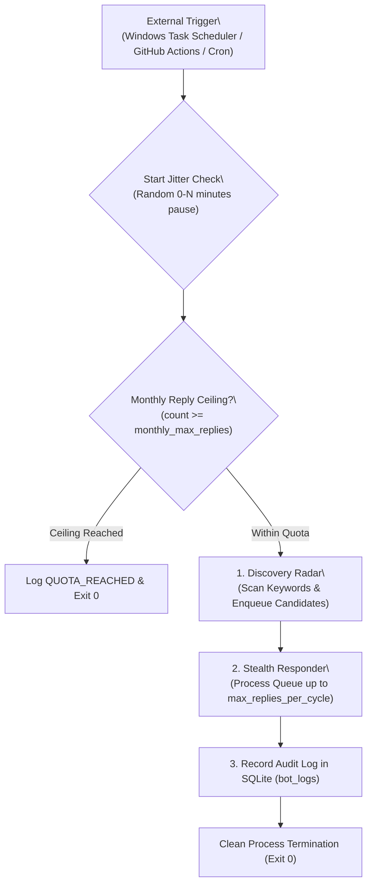

# Step 10: External Scheduler & Unified Pipeline Architecture

## 1. Problem Statement & Motivation
- **Context & Operational Profile**:
  - zioX targets a deliberate, high-impact volume of **20–30 replies per month** with a budget of \$0–\$4.
  - Running a 24/7 internal daemon loop (`while True: time.sleep()`) incurs unnecessary server costs (\$4–\$5/mo VPS), risks unhandled memory/socket leaks, and is an architectural mismatch for low-frequency operations.
- **Goal**:
  - Implement an **External Scheduler / Serverless Cron** architecture where the bot runs as a discrete, self-healing, single-cycle pipeline (`--pipeline`).
  - Provide humanized **Start Jitter** to randomize execution times and prevent clock-aligned bot detection.
  - Deliver deployment templates for both **Windows Task Scheduler** and **GitHub Actions**.

---

## 2. Architecture & Design Principles



### Key Engineering Pillars:
1. **Unified Pipeline (`--pipeline`)**:
   - Single command that triggers:
     1. Quota pre-check.
     2. Discovery Radar scan across all bilingual keywords.
     3. Priority queue processing with anti-ban stealth pacing and per-cycle reply caps (default: 2 replies).
     4. Audit recording in `bot_logs`.
2. **Start Jitter (`--start-jitter [minutes]`)**:
   - When external schedulers trigger at fixed intervals (e.g., every 3 hours at `:00`), start jitter inserts a randomized sleep (e.g., uniform random between `0` and `N` minutes) before initiating network calls to X.
   - Skipped in `dry_run` or when set to `0` for fast automated testing.
3. **Resilience & Self-Healing**:
   - Every invocation starts with a clean memory space and fresh connection pools.
   - Any transient network exception is safely recorded in `bot_logs` and the process exits cleanly.
4. **Zero-Cost Deployment Templates**:
   - Local: `scripts/run_pipeline.ps1` for Windows Task Scheduler.
   - Cloud: `.github/workflows/ziox_cron.yml` for GitHub Actions.

---

## 3. Files Touched

| File | Change |
|---|---|
| [`config/settings.py`](file:///C:/Users/User/PycharmProjects/zioX/config/settings.py) | Add `start_jitter_max_minutes` parameter. |
| [`engine/orchestrator.py`](file:///C:/Users/User/PycharmProjects/zioX/engine/orchestrator.py) | Add `run_full_pipeline()` coordinating radar, queue processing, and start-jitter. |
| [`main.py`](file:///C:/Users/User/PycharmProjects/zioX/main.py) | Add `--pipeline` and `--start-jitter` CLI arguments. |
| [`scripts/run_pipeline.ps1`](file:///C:/Users/User/PycharmProjects/zioX/scripts/run_pipeline.ps1) | PowerShell execution script for local Windows Task Scheduler. |
| [`.github/workflows/ziox_cron.yml`](file:///C:/Users/User/PycharmProjects/zioX/.github/workflows/ziox_cron.yml) | GitHub Actions workflow template for automated serverless execution. |
| [`tests/test_scheduler.py`](file:///C:/Users/User/PycharmProjects/zioX/tests/test_scheduler.py) | Comprehensive test suite for pipeline chaining, start jitter, and quota hard-stops. |

---

## 4. Verification & Testing Criteria
1. **Automated Unit Tests**:
   - `test_pipeline_executes_radar_then_responder`: Verifies end-to-end chaining of discovery and queue response.
   - `test_pipeline_respects_monthly_reply_ceiling`: Aborts before network operations if quota is exhausted.
   - `test_pipeline_applies_start_jitter`: Verifies random jitter delay calculation and sleep invocation.
   - `test_pipeline_handles_radar_exception_gracefully`: Captures scan failure, writes to `bot_logs`, and exits cleanly.
2. **Verification Command**:
   ```powershell
   .\.venv\Scripts\pytest tests/test_scheduler.py
   ```
