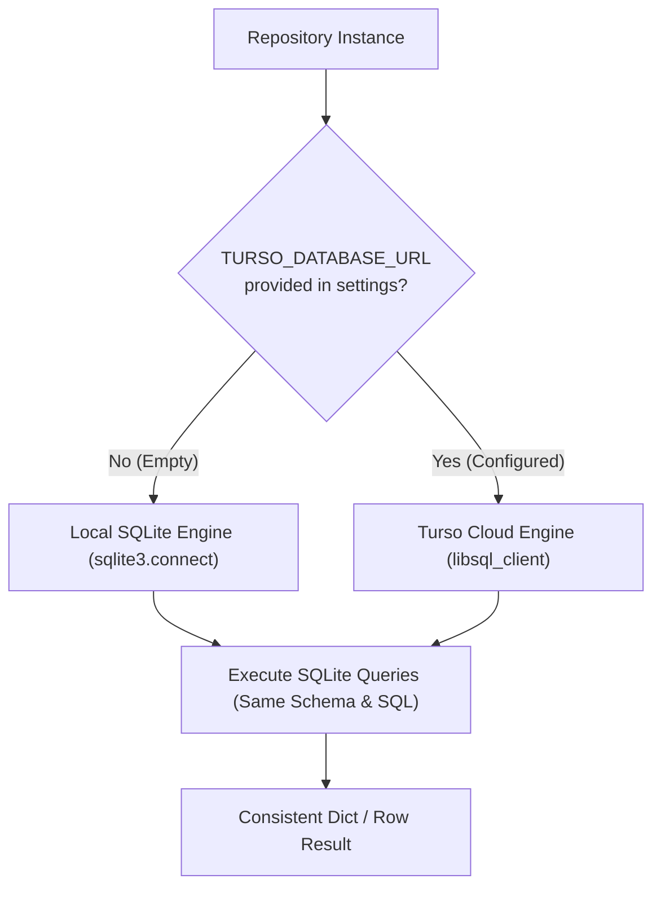

# Step 11: Cloud Persistence via Turso / libSQL Database Adapter

## 1. Problem Statement & Motivation
- **The Problem**: Running on GitHub Actions or serverless containers spins up ephemeral environments. A local SQLite file (`ziox.db`) is destroyed when the runner shuts down, causing the bot to lose reply counters, processed tweet deduplication, and thread state.
- **The Choice (Turso)**:
  - Turso is SQLite at the edge, offering a generous free tier (9 GB storage, 500 databases, 1B row reads/month).
  - It speaks SQLite natively and can be queried over HTTPS via `libsql_client` or the HTTP API, requiring zero server maintenance.
- **Goal**:
  - Implement a dual-mode database engine in `database/repository.py`:
    - **Local Mode (default)**: Uses standard Python `sqlite3` when `TURSO_DATABASE_URL` is empty (for fast local development, offline runs, and unit tests).
    - **Cloud Mode**: Connects to Turso (`libsql://...` or `https://...`) using `libsql_client` when `TURSO_DATABASE_URL` and `TURSO_AUTH_TOKEN` are provided in `.env` / GitHub Secrets.
  - Zero disruption to existing tests or offline development.

---

## 2. Architecture & Design Principles



### Key Principles:
1. **Drop-in Dual Mode**:
   - The application requires no code changes in `orchestrator`, `radar`, or `main.py`. The `Repository` interface remains 100% identical.
2. **Graceful Dependency Fallback**:
   - `libsql-client` is added as an optional or core dependency. If not installed in a minimal environment, `Repository` cleanly defaults to standard `sqlite3`.
3. **GitHub Actions Wiring**:
   - In `.github/workflows/ziox_cron.yml`, add `TURSO_DATABASE_URL` and `TURSO_AUTH_TOKEN` environment secrets, eliminating the need for Git-commit or cache hackery.

---

## 3. Files Touched

| File | Change |
|---|---|
| [`pyproject.toml`](file:///C:/Users/User/PycharmProjects/zioX/pyproject.toml) | Add `libsql-client>=0.3.0` dependency. |
| [`config/settings.py`](file:///C:/Users/User/PycharmProjects/zioX/config/settings.py) | Add `turso_database_url` and `turso_auth_token` settings fields. |
| [`database/repository.py`](file:///C:/Users/User/PycharmProjects/zioX/database/repository.py) | Support dual-engine connection: local `sqlite3` or remote Turso `libsql_client`. |
| [`.github/workflows/ziox_cron.yml`](file:///C:/Users/User/PycharmProjects/zioX/.github/workflows/ziox_cron.yml) | Pass `TURSO_DATABASE_URL` and `TURSO_AUTH_TOKEN` from repository secrets. |
| [`tests/test_turso_adapter.py`](file:///C:/Users/User/PycharmProjects/zioX/tests/test_turso_adapter.py) | Unit tests verifying configuration routing, dual-engine abstraction, and schema parity. |

---

## 4. Verification & Testing Criteria
1. **Automated Unit Tests**:
   - `test_repository_defaults_to_sqlite3_when_no_turso_url`: Verifies standard local fallback.
   - `test_repository_selects_turso_client_when_configured`: Verifies client instantiation when credentials exist.
   - `test_full_test_suite_passes_locally`: Confirms all 41 existing tests pass without regressions.
2. **Verification Command**:
   ```powershell
   .\.venv\Scripts\pytest
   ```
